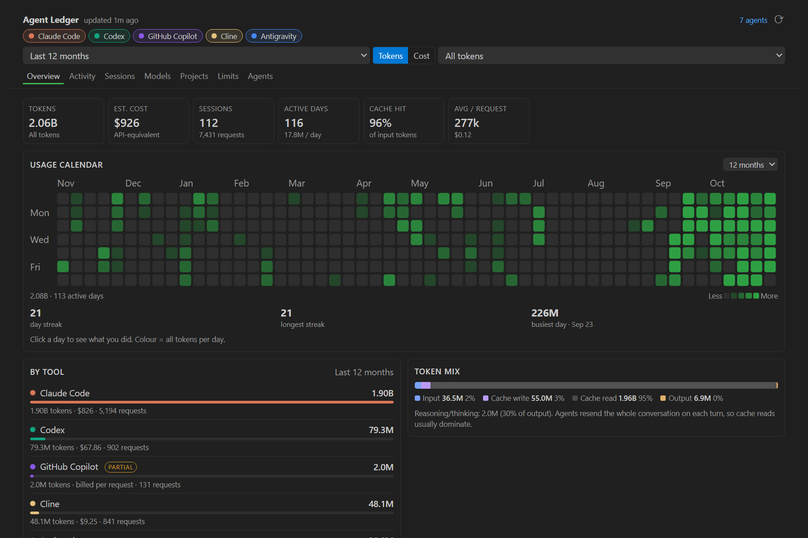
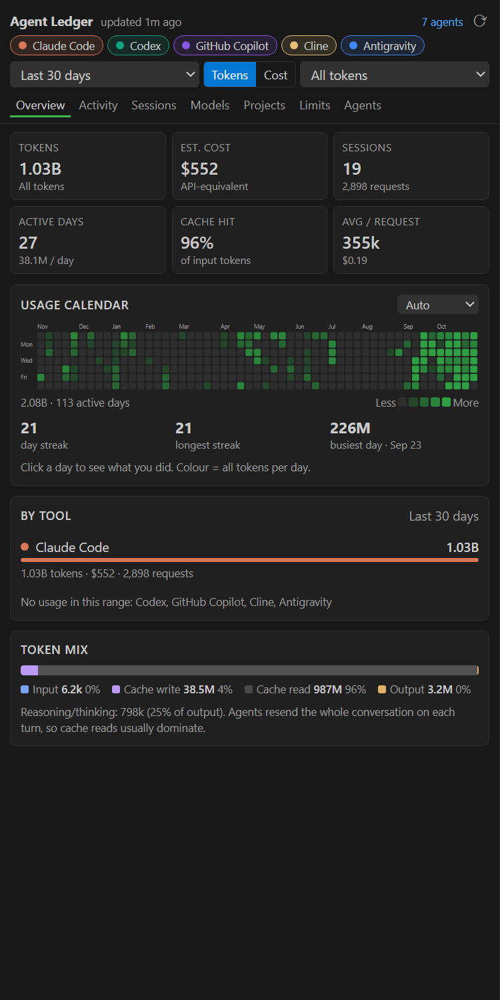
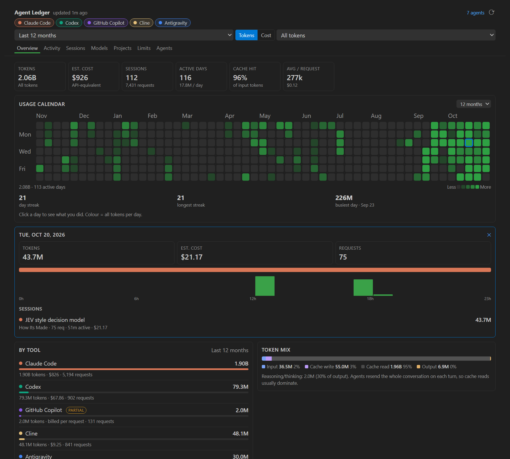
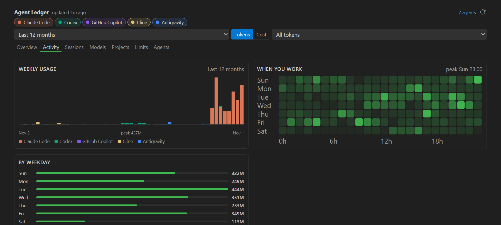
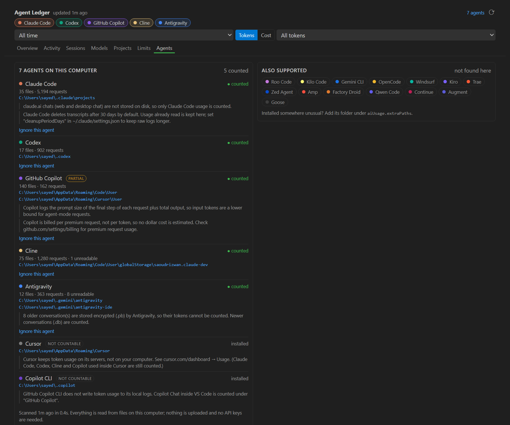

# Agent Ledger

**Every token your AI coding agents burn, in one ledger.**

> Install it and it finds the AI coding agents you use. It shows every token they've burned (GitHub-style calendar, cost, sessions, models, projects), read from the logs those tools already keep on your computer. **No API keys, no proxy, nothing uploaded.**

*Formerly **API Health Monitor**. v1 tracked direct API calls through a local proxy; Agent Ledger tracks coding agents from their own logs instead. v1 code is kept in [`v1/`](v1/).*



| Sidebar | Click any day |
|---|---|
|  |  |

---

## 🔍 Supported agents

The extension auto-detects all of these on first run and tells you what it found.

| Agent | Support | What's read |
|---|---|---|
| **Claude Code** (CLI, VS Code, JetBrains, desktop Code tab) | ✅ Full | `~/.claude/projects/**/*.jsonl` |
| **Codex** (CLI, IDE extension, desktop app) | ✅ Full + rate limits | `~/.codex/sessions/**/rollout-*.jsonl[.zst]` |
| **Cline** | ✅ Full + tool-reported cost | `<editor>/User/globalStorage/saoudrizwan.claude-dev/tasks` |
| **Roo Code** | ✅ Full + tool-reported cost | `…/globalStorage/rooveterinaryinc.roo-cline/tasks` |
| **Kilo Code** | ✅ Full + tool-reported cost | `…/globalStorage/kilocode.kilo-code/tasks` |
| **Gemini CLI** | ✅ Full | `~/.gemini/tmp/*/chats/*.jsonl` |
| **Antigravity** | ✅ Full (newer conversations) | `~/.gemini/antigravity*/conversations/*.db` |
| **OpenCode** | ✅ Full + tool-reported cost | `~/.local/share/opencode` (SQLite or JSON) |
| **GitHub Copilot Chat** | ⚠️ Partial | `<editor>/User/workspaceStorage/*/chatSessions` |
| Cursor, Windsurf, Kiro, Trae, Zed, Amp, Copilot CLI, Factory Droid, Qwen Code, Continue, Augment, Goose | ℹ️ Detected | Shown as installed, with the reason their usage can't be counted |

Extensions such as Cline and Copilot are found in **every VS Code-based editor**: VS Code, Insiders, VSCodium, Cursor, Windsurf, Antigravity, Trae, Kiro and Positron, plus Remote/WSL server installs. Works on Windows, macOS and Linux.

**Why some tools are "detected only":** Cursor, Windsurf, Amp and Trae keep usage on their servers, not on your computer. Inventing numbers for them would be worse than saying so. Agents you run *inside* those editors (Claude Code, Codex, Cline, Copilot) are still counted.

**Why Copilot is "partial":** Copilot Chat records the prompt size of only the last step of each request, plus total output. In agent mode, input is therefore a lower bound. Copilot bills per premium request rather than per token, so no dollar cost is estimated for it.

## ✨ Features

| | |
|---|---|
| 🟩 **Usage calendar** | GitHub-style contribution graph of tokens or cost per day, for 6 or 12 months or any year. Click a day for its sessions, tools and hourly breakdown. Shows current streak, longest streak and busiest day. |
| 📊 **Overview** | Tokens, cost, sessions, active days, cache hit rate, average per request and a month-end projection |
| 🧰 **By tool** | Every agent side by side. Click a chip to filter. |
| 📈 **Activity** | Daily or weekly stacked chart, a weekday × hour heatmap and totals by weekday |
| 💬 **Sessions** | Every session with its title, project, requests, active time, models and cost. Searchable and sortable. |
| 🤖 **Models** / 📁 **Projects** | Where your tokens and money went |
| ⏱ **Limits** | Codex rate-limit windows, plus "API value you got for your plan" for each tool |
| 🔌 **Agents** | What was found where, what can't be read and why. Ignore an agent with one click. |
| 📌 **Status bar** | Today's tokens and cost |
| 📤 **CSV export** | Every request as a row |





## 💰 How cost is calculated

1. **Reported cost.** When the tool logs its own cost (Cline, Roo Code, Kilo Code, OpenCode), that number is used.
2. **Estimated cost.** Otherwise, tokens are priced at public API list prices (Nov 2026), including cache reads and writes. If you're on a subscription you actually pay your plan price, so set `aiUsage.subscriptions` to see how much value you get from it.
3. **Not billed per token.** Copilot shows "billed per request".

Override any model's price with `aiUsage.pricing`.

## ✅ Accuracy

Each parser has tests built from real log samples (`npm test`). On the author's machine, totals were checked against independent recounts:
- **Claude Code:** exact match on every token field.
- **Codex:** exact match with Codex's own per-session totals.
- **Cline:** exact match with Cline's own per-task totals.

Other details:
- Responses that appear in more than one file are counted once.
- Claude Code deletes transcripts after 30 days. **This extension keeps the usage it has already read**, so your history keeps growing.

## ⚙️ Settings

| Setting | Default | |
|---|---|---|
| `aiUsage.refreshIntervalMinutes` | `5` | Rescan interval. Unchanged files are skipped, so rescans are cheap. |
| `aiUsage.statusBar` | `true` | Today's usage in the status bar |
| `aiUsage.subscriptions` | `{}` | Monthly plan price per agent id, e.g. `{ "claude-code": 100, "codex": 8 }` |
| `aiUsage.pricing` | `{}` | Price overrides (USD per 1M tokens), e.g. `{ "gpt-5.6-luna": { "input": 0.2, "output": 1.2, "cacheRead": 0.02 } }` |
| `aiUsage.disabledAgents` | `[]` | Agent ids to ignore |
| `aiUsage.extraPaths` | `{}` | Extra data folders per agent id, for unusual installs |

Agent ids: `claude-code`, `codex`, `copilot-chat`, `cline`, `roo-code`, `kilo-code`, `gemini-cli`, `antigravity`, `opencode`.

Commands: **Rescan Logs**, **Open Full Dashboard**, **Export Usage as CSV**, **Show Scan Log**, **Clear Cache and Rescan Everything**.

## 🔒 Privacy

The extension only *reads* the files listed above and makes **no network requests**. It stores a cache of token counts (not your prompts) in VS Code's extension storage. Session titles come from the tools' own titles, or from the first line of your first prompt when a tool has none.

## 🧩 Adding an agent

Each agent is a self-contained provider:

```ts
export interface Provider {
  id: string; name: string; color: string;
  support: 'full' | 'partial' | 'detect-only';
  version: number;                                  // bump to re-parse cached files
  discover(ctx): Promise<{ roots; files; notes? }>; // find data folders + files
  parse?(file): Promise<FileResult>;                // file -> usage records
  enrich?(ctx, roots, sessions, records): Promise<void>; // titles/projects from index files
}
```

1. Add `src/providers/<agent>.ts`.
2. Register it in `src/providers/index.ts`.
3. Add a test with a fixture in `src/test/`.

The scanner handles caching, parallel parsing, de-duplication and history retention.

## 🚀 Development

```bash
npm install
npm test                 # compile + 20 unit tests
node out/smoke.js        # scan this machine's real logs from the terminal
npx @vscode/vsce package
```

```
src/
  extension.ts            activation, webviews, status bar, commands
  core/                   scanner (cache, concurrency), payload, pricing, paths, sqlite, protobuf
  providers/              one file per agent + index.ts registry
  test/                   node:test unit tests with generated fixtures
media/                    dashboard UI (vanilla JS + SVG, no libraries)
```

## License

MIT
